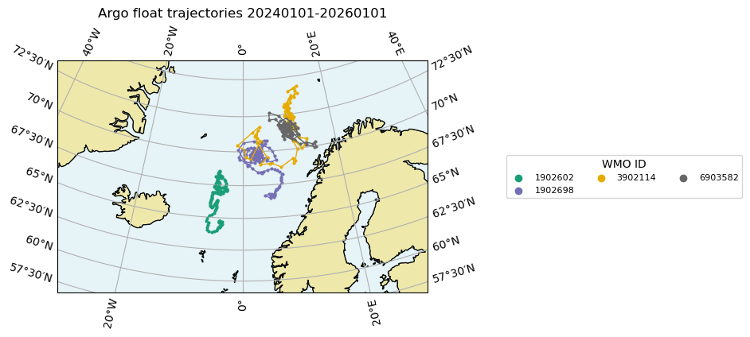
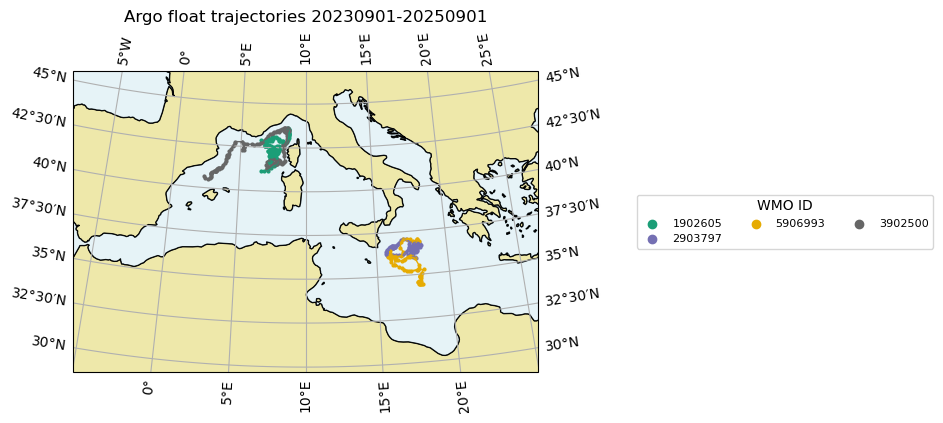

## Script for EAONE Task 1.4 augmented BGC profiles

### Settings

- Depth range: 0-300m
- Time range:
    - Norwegian Sea: 01/01/2024-12/31/2025
    - Mediterranean Sea: 10/01/2023-09/30/2025
- Parameters:
    - CPHL
    - BBP700
- Target Argo floats:  
    - Norwegian Sea:
        - O2 Argo: 3902114, 6903582
        - BGC Argo: 1902698, 1902602
    - Mediterranean Sea:
        - O2 Argo: 5906993, 3902500
        - BGC Argo: 1902605, 2903797

### Argo float selection

**Note:** See [notebook](https://github.com/tsuyoshiwakamatsu/EAONE_T14_augmented_BGC/blob/main/note/WP1_Argo_selection.ipynb) for further detail.

#### Norwegian Sea

| WMO | Type | TEMP | PSAL | DOX2 | CPHL | BBP700 | Operation Period |
|---|:---:|:---:|:---:|:---:|:---:|:---:|---|
| [1902698](https://fleetmonitoring.euro-argo.eu/float/1902698) | BGC | ✓ | ✓ | ✓ | ✓ | ✓ | 2024-06-09 – 2026-08-23 |
| [1902602](https://fleetmonitoring.euro-argo.eu/float/1902602) | BGC | ✓ | ✓ | ✓ | ✓ | ✓ | 2023-05-25 – current |
| [3902114](https://fleetmonitoring.euro-argo.eu/float/3902114) | O2 | ✓ | ✓ | ✓ |   |   | 2021-07-07 – current |
| [6903582](https://fleetmonitoring.euro-argo.eu/float/6903582) | O2 | ✓ | ✓ | ✓ |   |   | 2021-05-01 – current |

#### Mediterranean Sea

| WMO | Type | TEMP | PSAL | DOX2 | CPHL | BBP700 | Operation Period |
|---|:---:|:---:|:---:|:---:|:---:|:---:|---|
| [1902605](https://fleetmonitoring.euro-argo.eu/float/1902605) | BGC | ✓ | ✓ | ✓ | ✓ | ✓ | 2023-11-20 – current |
| [2903797](https://fleetmonitoring.euro-argo.eu/float/2903797) | BGC | ✓ | ✓ | ✓ | ✓ | ✓ | 2021-07-08 – 2024-12-25 |
| [5906993](https://fleetmonitoring.euro-argo.eu/float/5906993) | O2 | ✓ | ✓ | ✓ |   |   | 2023-11-26 – current |
| [3902500](https://fleetmonitoring.euro-argo.eu/float/3902500) | O2 | ✓ | ✓ | ✓ |   |   | 2023-05-05 – 2026-10-22 |

### Inter-comparison matrix

#### Norwegian Sea O2 Argo (3902114, 6903582)

| Package | SOCA | OGS | SubMAPP | BGC Argo |
|---|:---:|:---:|:---:|---|
| SOCA     |     |  ●  | ●  | |
| OGS      |  ✓ |     |  ✓  | |
| SubMAPP  |  ○  |  ○  |     | |
| BGC Argo |     |     |     | | 

**Note:** ● SOCA reprocessing ; ○ SubMAPP reprocessing ; ✓ Exisiting Product

#### Norwegian Sea BGC Argo (3902114, 6903582)

| Package | SOCA | OGS | SubMAPP | BGC Argo |
|---|:---:|:---:|:---:|---|
| SOCA     |     |  ●  |  ● | ● |
| OGS      |  ✓  |     | ✓  |   |
| SubMAPP  |  ○ |  ○ |     | ○ |
| BGC Argo |  ✓  |  ✓  |  ✓ |   | 

**Note:** ● SOCA reprocessing ; ○ SubMAPP reprocessing ; ✓ Exisiting Product

#### Mediterranean Sea O2 Argo (5906993, 3902500)

| Package | SOCA | OGS | SubMAPP | BGC Argo |
|---|:---:|:---:|:---:|---|
| SOCA     |     |  ●  |    |   |
| OGS      |  ✓  |     |    |   |
| SubMAPP  |    |    |     |   |
| BGC Argo |     |     |     | | 

**Note:** ● SOCA reprocessing ; ○ SubMAPP reprocessing ; ✓ Exisiting Product

#### Mediterranean Sea BGC Argo (1902605, 2903797)

| Package | SOCA | OGS | SubMAPP | BGC Argo |
|---|:---:|:---:|:---:|---|
| SOCA     |     |  ●  |    | ● |
| OGS      |  ✓  |     |    |  |
| SubMAPP  |    |    |     |  |
| BGC Argo |  ✓  |    |    |   | 

**Note:** ● SOCA reprocessing ; ○ SubMAPP reprocessing ; ✓ Exisiting Product

